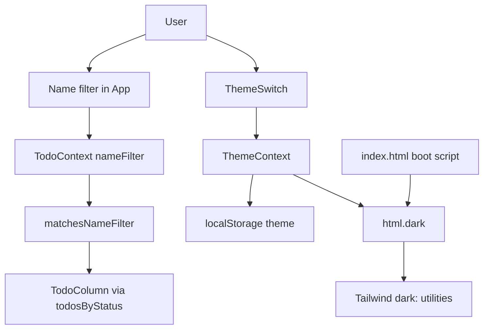

# Board Filter and Theme Design

**Spec**: `.specs/features/board-filter-theme/spec.md`
**Status**: Draft

---

## Architecture Overview

Two small domain modules plus two React seams that already exist.

1. **Filter** — `matchesNameFilter` decides visibility. `TodoContext` holds the query string (session only) and applies it when building `todosByStatus`. Columns keep rendering all three columns; empty filtered columns reuse "No tasks".
2. **Theme** — `resolveInitialTheme` / `toggleTheme` own the spec rules. A blocking script in `index.html` applies the `dark` class before React paints. `ThemeContext` keeps React in sync, writes `localStorage.theme`, and toggles the same class. UI uses Tailwind `dark:` utilities (AD-001).



---

## Code Reuse Analysis

### Existing Components to Leverage

| Component | Location | How to Use |
| --------- | -------- | ---------- |
| `todosByStatus` grouping | `src/contexts/TodoContext.tsx` | Apply name filter in the same map that splits by status |
| Column empty copy | `src/components/TodoColumn.tsx` | Unchanged "No tasks" when the filtered list is empty |
| Context + localStorage pattern | `src/contexts/TodoContext.tsx` | Same `useState` initializer + `useEffect` persist for theme |
| App chrome | `src/App.tsx` | Filter field near add-task form; switch in a top-right absolute/flex slot |
| Heroicons | `@heroicons/react` | Sun/moon (or similar) icons on the switch |
| Tailwind utilities | existing `className`s | Add `dark:` counterparts; do not introduce a new CSS framework |

### Integration Points

| System | Integration Method |
| ------ | ------------------ |
| `localStorage` | Key `theme` values `light` \| `dark`; todos/tags keys unchanged |
| `prefers-color-scheme` | Read only when `theme` is absent; via `matchMedia` in boot script and `resolveInitialTheme` |
| Tailwind v4 | `@custom-variant` in `src/styles.css` (official class strategy) |

---

## Components

### `matchesNameFilter` / `normalizeFilterQuery`

- **Purpose**: Literal, case-insensitive substring match; whitespace-only query matches everything.
- **Location**: `src/lib/cardFilter.ts`
- **Interfaces**:
  - `normalizeFilterQuery(query: string): string` — trim
  - `matchesNameFilter(cardText: string, query: string): boolean` — true when query is empty after trim, else `cardText.toLowerCase().includes(normalized.toLowerCase())`
- **Dependencies**: none
- **Reuses**: `String.prototype.includes` (literal, not `RegExp`)

### `resolveInitialTheme` / `toggleTheme`

- **Purpose**: First-visit OS default, stored override, and toggle.
- **Location**: `src/lib/theme.ts`
- **Interfaces**:
  - `Theme` — `'light' \| 'dark'`
  - `THEME_STORAGE_KEY` — `'theme'`
  - `readStoredTheme(raw: string \| null): Theme \| null`
  - `resolveInitialTheme(stored: string \| null, prefersDark: boolean): Theme`
  - `toggleTheme(current: Theme): Theme`
- **Dependencies**: none (I/O stays in context and boot script)
- **Reuses**: none

### Theme boot script

- **Purpose**: Apply `html.dark` before first paint so THEME-01/02 hold on load.
- **Location**: `index.html` (inline, non-module)
- **Interfaces**: Reads `localStorage.theme` and `matchMedia('(prefers-color-scheme: dark)')`; same rules as `resolveInitialTheme`
- **Dependencies**: `src/lib/theme.ts` rules (duplicated on purpose; modules cannot run in a blocking classic script without a extra file)
- **Reuses**: AD-001 class name `dark`

### `ThemeProvider` / `useTheme`

- **Purpose**: React state for theme, persist on toggle, keep `document.documentElement` class aligned.
- **Location**: `src/contexts/ThemeContext.tsx`
- **Interfaces**:
  - `ThemeProvider({ children })`
  - `useTheme(): { theme: Theme; toggleTheme: () => void }`
- **Dependencies**: `src/lib/theme.ts`
- **Reuses**: `TodoProvider` context shape

### `ThemeSwitch`

- **Purpose**: Control that calls `toggleTheme`.
- **Location**: `src/components/ThemeSwitch.tsx`
- **Interfaces**: no props; uses `useTheme`
- **Dependencies**: `ThemeContext`, Heroicons
- **Reuses**: existing button/hover class style

### Name filter control

- **Purpose**: Controlled text input bound to `nameFilter`.
- **Location**: `src/App.tsx` (inline; not a new abstraction)
- **Interfaces**: `value={nameFilter}` / `onChange` → context setter
- **Dependencies**: `useTodoContext`
- **Reuses**: existing add-task input classes plus `dark:` variants

---

## Data Models (if applicable)

### Filter query

```typescript
// TodoContext session state — not persisted
nameFilter: string
setNameFilter: (query: string) => void
```

**Relationships**: Applied when computing `todosByStatus`. Does not change stored `Todo` records.

### Theme

```typescript
type Theme = "light" | "dark"
// localStorage key "theme" stores Theme after the first explicit toggle
```

**Relationships**: Independent of todos/tags.

### `todosByStatus` (behavior change)

```typescript
{
  todo: Todo[]   // status === "todo" AND matchesNameFilter(text, nameFilter)
  doing: Todo[]
  done: Todo[]
}
```

**Relationships**: `TodoColumn` already maps this list and shows "No tasks" when length is 0. Drag-and-drop while a filter is active uses the visible list; that interaction is unspecified in the spec and is accepted as-is.

---

## Error Handling Strategy

| Error Scenario | Handling | User Impact |
| -------------- | -------- | ----------- |
| `localStorage` missing or throws | `resolveInitialTheme(null, prefersDark)`; toggle no-ops persist in try/catch | Theme still follows OS; switch still flips in-session |
| Corrupt `theme` value | Treat as missing (`readStoredTheme` → null) | Falls back to OS preference |
| Filter with regex metacharacters | `includes`, never `new RegExp` | Characters match literally |
| Empty / whitespace filter | Trim then show all cards | Board restored |

---

## Risks & Concerns

| Concern | Location (file:line) | Impact | Mitigation |
| ------- | -------------------- | ------ | ---------- |
| `TodoContext` is already a large bag of state | `src/contexts/TodoContext.tsx:71` | Filter logic could bloat it further | Keep matching in `cardFilter.ts`; context only stores the string |
| No test runner or tests | `package.json` scripts | ACs cannot be gated | Introduce Vitest + Testing Library (AD-002); domain tests 1:1 with filter/theme ACs |
| Light-only utilities on every surface | `src/App.tsx`, `TodoCard.tsx`, `TodoColumn.tsx`, `TagChip.tsx` | Dark mode would miss cards/forms if only the page background changes | Per-component `dark:` pass covering spec surfaces |
| Boot script vs `theme.ts` duplication | `index.html` vs `src/lib/theme.ts` | Drift on first-load rules | Same key and value set; unit tests lock the TS copy |
| DnD indices while filtered | `src/contexts/TodoContext.tsx:224` | Drop among hidden cards can surprise | Out of spec; use filtered `todosByStatus` (visible neighbors only) |
| `react-refresh/only-export-components` on context files | `eslint.config.js:22` | Warn on `useTheme` export | Same allow-pattern as `TodoContext` |

---

## Tech Decisions (only non-obvious ones)

| Decision | Choice | Rationale |
| -------- | ------ | --------- |
| Tailwind dark strategy | Class on `<html>` + `@custom-variant` (AD-001) | Manual toggle cannot use the v4 media default |
| Filter application point | Inside `todosByStatus` | Columns and empty state already consume that object |
| Filter UI | Inline in `App.tsx` | One field, no reuse yet |
| Theme UI | `ThemeSwitch` component | Placement in App stays a one-line slot in the top-right |
| Tests | Vitest + RTL + jsdom (AD-002) | Repo had none; Vite-native runner |
| FOUC | Blocking inline script in `index.html` | Spec requires the correct theme on load, not after hydration |

**Project-level:** AD-001 and AD-002 in `.specs/STATE.md`.
